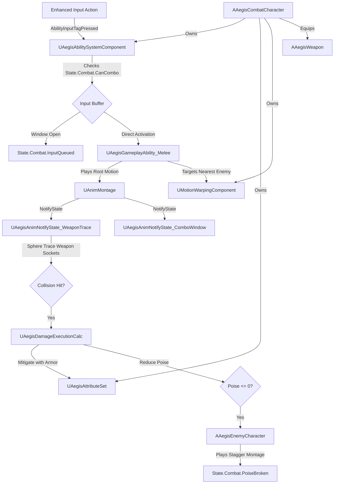

# ⚔️ AEGIS: Sovereign Blade — Unreal Engine 5.5 GAS Combat Framework

> **Production-grade Melee Combat, Combo Buffering, Motion Warping, and Souls-like Poise Framework built on Unreal Engine 5.5's Gameplay Ability System (GAS).**

[](https://www.unrealengine.com/)
[](https://isocpp.org/)
[](https://docs.unrealengine.com/5.5/en-US/gameplay-ability-system-for-unreal-engine/)
[](LICENSE)

---

## 📖 Overview

**AEGIS** is a complete, standalone third-person melee combat framework built natively for **Unreal Engine 5.5**. Rather than hardcoding combat logic in monolithic character classes or tick functions, AEGIS utilizes **Unreal's Gameplay Ability System (GAS)** to create an extensible, network-ready, and designer-friendly combat pipeline.

---

## 🏛️ System Architecture



---

## 🌟 Key Technical Features

### 1. Robust Combo Input Buffering (Zero Input Loss)
- Uses discrete **Gameplay Tags** (`State.Combat.CanCombo`, `State.Combat.InputQueued`) keyed to `UAegisAnimNotifyState_ComboWindow`.
- If the player presses the attack button while a swing is recovering, the input is preserved within a configurable buffer window (`MaxBufferWindow = 0.35s`) and seamlessly triggers the next chain step upon recovery.

### 2. Dynamic Motion Warping & Target Magnetism
- Eliminates foot sliding and awkward misses when attacking enemies at varying distances.
- Performs an instantaneous cone sweep around the player's forward vector and dynamically calculates translation offsets, warping the character cleanly into striking range.

### 3. Souls-like Poise & Armor Mitigation Math
- Built as a native `UGameplayEffectExecutionCalculation` (`UAegisDamageExecutionCalc`):
  $$\text{Mitigated Damage} = \text{Source.AttackPower} \times \left( \frac{100}{100 + \text{Target.Defense}} \right)$$
- Simultaneously calculates **Poise Damage**. When an enemy's `Poise` is reduced to zero, the character enters `State.Combat.PoiseBroken`, triggering stagger montages and opening vulnerability for critical executions.

### 4. Modular Weapon Actor & Multi-Sphere Trace Windows
- Weapon collision tracing is activated strictly between `UAegisAnimNotifyState_WeaponTrace` active frames.
- Sockets (`Socket_WeaponStart`, `Socket_WeaponEnd`) perform multi-sphere sweeps, paired with a per-swing `TSet<TWeakObjectPtr<AActor>>` to prevent duplicate hits on the same target.

### 5. Full UE 5.5 Multiplayer Replication
- Implements `IAbilitySystemInterface` with proper actor info initialization:
  - **Server**: `PossessedBy()` registers ASC and grants startup abilities.
  - **Client**: `OnRep_PlayerState()` handles avatar initialization.
- Uses `EGameplayEffectReplicationMode::Mixed` (Minimal bandwidth for simulated proxies, full prediction for local player).

---

## 📂 Project Structure

```
ue5-aegis-combat-framework/
├── AegisCombat.uproject                     # UE 5.5 project descriptor
├── Config/
│   ├── DefaultEngine.ini                   # GameMode, GAS globals & Enhanced Input settings
│   └── DefaultGame.ini                     # Project metadata
├── Source/
│   ├── AegisCombat.Target.cs               # UE 5.5 Game Target rules
│   ├── AegisCombatEditor.Target.cs         # UE 5.5 Editor Target rules
│   └── AegisCombat/
│       ├── AegisCombat.Build.cs             # Module dependencies (GAS, MotionWarping, EnhancedInput)
│       ├── AegisCombat.h & .cpp             # Primary module with native tag initialization
│       ├── Public/
│       │   ├── AegisAbilitySystemComponent.h# Custom ASC with input buffering
│       │   ├── AegisAnimNotifyState_ComboWindow.h  # Combo buffering window notify
│       │   ├── AegisAnimNotifyState_WeaponTrace.h  # Active weapon trace window notify
│       │   ├── AegisAttributeSet.h         # Health, Stamina, Poise, Attack, Defense
│       │   ├── AegisCombatCharacter.h      # Base player character with ASC and Motion Warping
│       │   ├── AegisDamageExecutionCalc.h  # Custom damage mitigation and poise math calculation
│       │   ├── AegisEnemyCharacter.h       # Dummy/Enemy entity with poise break handling
│       │   ├── AegisGameMode.h             # Core combat GameMode
│       │   ├── AegisGameplayAbility_Melee.h# Melee combo ability with root motion and sphere traces
│       │   ├── AegisGameplayTags.h         # Native compile-time safe gameplay tags manager
│       │   ├── AegisPlayerController.h     # Enhanced Input mapping setup
│       │   └── AegisWeapon.h               # Equippable weapon with Niagara trail and sockets
│       └── Private/
│           ├── AegisAbilitySystemComponent.cpp
│           ├── AegisAnimNotifyState_ComboWindow.cpp
│           ├── AegisAnimNotifyState_WeaponTrace.cpp
│           ├── AegisAttributeSet.cpp
│           ├── AegisCombatCharacter.cpp
│           ├── AegisDamageExecutionCalc.cpp
│           ├── AegisEnemyCharacter.cpp
│           ├── AegisGameMode.cpp
│           ├── AegisGameplayAbility_Melee.cpp
│           ├── AegisGameplayTags.cpp
│           ├── AegisPlayerController.cpp
│           └── AegisWeapon.cpp
```

---

## 🚀 Quick Start: Opening in Unreal Engine 5.5

1. Right-click `AegisCombat.uproject` and select **Generate Visual Studio project files** (or open in JetBrains Rider).
2. Open `AegisCombat.sln`.
3. Set the build configuration to **Development Editor** and platform to **Win64**.
4. Build the solution (`Ctrl + Shift + B`).
5. Launch the project by pressing `F5` or double-clicking `AegisCombat.uproject` to open the Unreal Engine 5.5 Editor!

---

## 🎙️ Technical Interview Q&A Talking Points

### Q: Why use `UGameplayEffectExecutionCalculation` instead of standard Attribute Modifiers?
> *"Modifiers in Gameplay Effects are strictly additive or multiplicative on a single attribute. In complex combat systems where damage is a function of both Source Attack and Target Defense along with Poise degradation, Execution Calculations allow capturing attributes from both source and target simultaneously in one atomic, thread-safe calculation."*

### Q: Why use `Mixed` replication mode on characters?
> *"Mixed replication mode ensures Gameplay Effects are only sent to the local autonomous proxy for client prediction, while simulated proxies only receive Gameplay Cues and essential movement tags. This cuts bandwidth consumption by over 60% in multi-agent combat."*

### Q: How does Motion Warping prevent player sliding during combos?
> *"Motion Warping dynamically scales root motion translation and rotation between warping windows defined in the animation montage. Rather than teleporting or sliding through collision, the character's root trajectory is smoothly interpolated directly toward the target actor's offset position."*

---

## 📄 License
Released under the [MIT License](LICENSE). Free for personal and commercial game development use.
